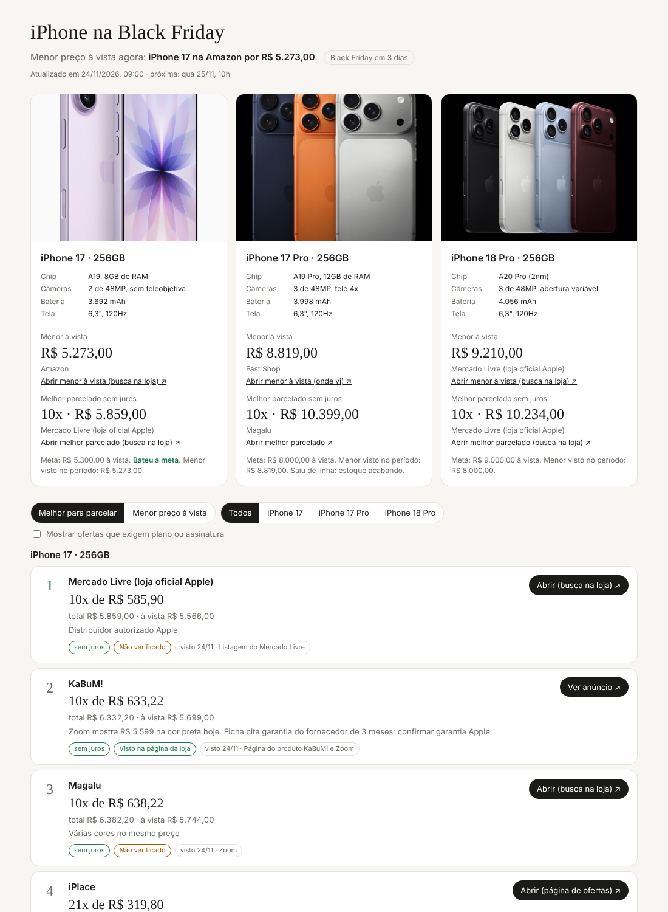

# Radar de Preços: uma skill para monitorar a Black Friday com IA

Diga ao seu assistente de IA o que você quer comprar. Ele pesquisa os preços em várias lojas, monta um painel com o ranking de **menor preço à vista** e **melhor parcelamento sem juros** (com o link de cada oferta) e, se o assistente tiver tarefas agendadas, atualiza tudo sozinho todo dia até a Black Friday. No dia, entrega o ranking final e diz se a promoção é melhor mesmo ou se a semana estava mais barata.



Nasceu de um caso real: comparar iPhone 17, 17 Pro e 18 Pro na Black Friday de 2026. O painel acima é desse monitoramento.

## O que ela faz

- Pergunta quais produtos você quer acompanhar (qualquer produto: celular, TV, notebook, air fryer...), a data do evento e se você prefere à vista ou parcelado.
- Busca em mais de 15 lojas brasileiras (Amazon, Mercado Livre oficial, Magalu, KaBuM!, Fast Shop, Casas Bahia, Carrefour, Americanas, lojas oficiais das marcas, operadoras...).
- Separa o que foi **visto na página da loja** do que veio de notícia ou comparador, e marca ofertas suspeitas: relâmpago, cupom só para assinante, vendedor terceiro, parcelamento que exige plano.
- Monta um painel com foto e ficha de cada produto para comparar lado a lado, o melhor preço de cada um e uma lista ordenada com o link para o anúncio.
- Agenda uma atualização por dia até o evento e um ranking final no dia, guardando o histórico para comparar.

Ela nunca compra nada nem entra na sua conta. A decisão e o carrinho são seus.

## Instalar

### Claude (claude.ai, app desktop e celular)

1. Baixe o [`radar-de-precos.zip`](radar-de-precos.zip) deste repositório.
2. Em **Configurações > Capabilities**, deixe ligado **Code execution and file creation**.
3. Vá em **Customize > Skills**, clique em **+**, depois em **Create skill > Upload a skill**, e envie o zip.
4. Numa conversa nova, peça: *"quero monitorar o preço do PS5 Pro e da TV LG C5 de 55 até a Black Friday"*.

Se você tiver tarefas agendadas no Claude, a skill cria as atualizações diárias sozinha.

### Claude Code

```bash
git clone https://github.com/rafaelzilli-droid/radar-black-friday.git
mkdir -p ~/.claude/skills
cp -r radar-black-friday/radar-de-precos ~/.claude/skills/
```

O painel é gerado numa pasta `radar/` (abra o `painel.html` no navegador).

### Outras IAs (ChatGPT, Gemini, etc.)

Copie o conteúdo de [`radar-de-precos/SKILL.md`](radar-de-precos/SKILL.md) e dos arquivos em `references/` como instrução do seu assistente (ou de um GPT/Gem personalizado), junto com o [`painel.html`](radar-de-precos/assets/painel.html). O agendamento depende de o assistente ter tarefas programadas; sem isso, é só voltar e pedir "atualiza meu radar".

## Ver o painel de exemplo

Baixe a pasta `radar-de-precos/assets/` e abra o `painel.html`: ele já vem com os dados reais dos iPhones (`dados.js`).

## Estrutura

```
radar-de-precos/
├── SKILL.md                      instruções da skill
├── references/
│   ├── coleta.md                 lojas, como verificar, sinais de alerta
│   ├── formato-dos-dados.md      formato que o painel lê
│   └── rotina.md                 instrução das atualizações agendadas
└── assets/
    ├── painel.html               o painel (HTML único, sem dependências)
    ├── dados.js                  dados que o painel mostra
    └── dados-exemplo.js          exemplo real (iPhones, nov/2026)
```

## Avisos

- Preços mudam a cada hora na Black Friday. Confira sempre no carrinho antes de pagar.
- A IA pode errar: o painel mostra de onde veio cada preço e quando foi visto, justamente para você checar.
- As fotos do exemplo são carregadas das páginas oficiais da Apple e pertencem a ela.

Feito por Rafael Zilli · Manobra Studio · licença MIT.
